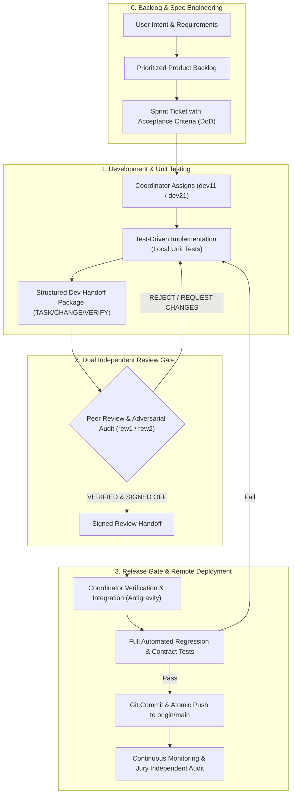

# Engineering Operating Model & Quality Gates Framework

**System:** Knowledge OS / RAG-Spark  
**Architecture:** Multi-Agent Autonomous Engineering Team  
**Roles & Topology:**
- **Coordinator & Release Manager:** `Antigravity` (`w4:p19`) — Git push authority, backlog curation, CI/CD orchestration.
- **Backend / Agentic Engineer:** `dev11` (`w4:p1A`) — V3 stream (Agent Runtime, Tools, Research Engine).
- **Workflow & Adapter Engineer:** `dev21` (`w4:p1B`) — V4 stream (Visual Workflows, Langflow Adapter, DSL Compiler).
- **Independent Quality & Security Reviewer (Stream A):** `rew1` (`w4:p1D`) — Reviewer for `dev11` (V3).
- **Independent Quality & Security Reviewer (Stream B):** `rew2` (`w4:p1E`) — Reviewer for `dev21` (V4).
- **Independent Quality Auditor:** `jury` (`w4:p1C`) — Systemic audit, adversarial probes, benchmark verification.

---

## 1. High-Level Delivery Lifecycle

---

## 2. Professional Quality Gates (G0 – G4)

Inspired by Tier-1 software engineering frameworks (e.g., Google Trunk-Based Development, Microsoft Engineering Rigor, Amazon Two-Pizza Teams with Bar Raisers), every change must pass five explicit gates:

| Gate | Name | Gatekeeper | Strict Exit Criteria |
|---|---|---|---|
| **G0** | **Definition of Ready (DoR)** | `Antigravity` (Coordinator) | - Problem statement clearly articulated. - Explicit Acceptance Criteria (Given/When/Then). - Security/Isolation impact assessed (e.g., R-004 workspace isolation). - Reusable library mapped before custom code is permitted. |
| **G1** | **Developer Verification (DoD)** | `dev11` / `dev21` | - 100% clean unit tests for new/modified components. - No untyped interfaces (strict Pydantic v2 / MyPy compliance). - Zero lint/formatting issues (Ruff, Flake8). - Complete developer handoff document created. |
| **G2** | **Adversarial Peer Review** | `rew1` / `rew2` (Bar Raisers) | - Independent execution of all test suites (cannot trust developer logs). - Minimum 10+ hostile adversarial edge-case probes (recursion, AST bypass, cycles, resource bounds). - Zero regressions in existing baseline. - Formal signed review ledger entry. |
| **G3** | **Integration & Regression Gate** | `Antigravity` (Coordinator) | - Clean merge into integration workspace. - Full contract and cross-package suite passes. - No broken imports or stale registry references. - Docker containers/services health verified if affected. |
| **G4** | **Deployment & Release Gate** | `Antigravity` (Sole Authority) | - Atomic, clean Git commit with standard conventional commit message. - Pushed directly to `https://github.com/intaiianuarie-maker/rag-spark.git`. - 10-minute progress report updated for user visibility. |

---

## 3. Team Responsibilities & Workflow Protocol

### A. Coordinator (`Antigravity`)
- **Authority:** Exclusively holds Git push rights to remote GitHub repository.
- **Workflow:**
  1. Translates user priority directives (e.g., Prio 1 = V1/V2, Prio 2 = V3/V4) into atomic slices.
  2. Dispatches work packages with clear constraints.
  3. Validates peer-review handovers before staging.
  4. Publishes 10-minute cadence status reports with delta percentages.

### B. Developers (`dev11` for V3, `dev21` for V4)
- **Protocol:**
  - Work in small, isolated incremental slices (max 200–400 LOC per iteration).
  - Never modify core protected runtime files without coordinator sign-off.
  - When completing work, generate a formal handover (`DEVxx-Vxx-HANDOFF.md`):
    - `TASK`: Ticket identifier & scope.
    - `CHANGE`: Exact list of files created or modified.
    - `WHY`: Architectural justification.
    - `REUSED`: Standard packages/libraries utilized.
    - `VERIFY`: Exact bash commands used to verify.
    - `RISKS`: Potential breaking points or limitations.

### C. Reviewers (`rew1` for V3, `rew2` for V4)
- **Protocol:**
  - Act as objective "Bar Raisers" with strict rejection authority.
  - Reject upon encountering:
    - Any syntax error, broken import, or uncaught exception.
    - Recursive loops without depth-limiting guards.
    - Security vulnerabilities (RCE, unsafe deserialization, unvetted eval/exec).
    - Unsubstantiated claims without independent reproducible command output.
  - Generate a formal review ledger (`REWxx-Vxx-HANDOFF.md`) marking verdict as either `ACCEPTED` or `REJECTED - REQUEST CHANGES`.

---

## 4. Continuous Feedback & Audit Loop

- **Role of the Jury:** Periodically inspects runtime artifacts, logs, and benchmark reports independently of the feature delivery cadence.
- **Defect Remediation:** When issues are flagged in audits (such as the 17 quality findings in `ISSUES-REMEDIATION-PLAN.md`), the coordinator ingests them into the backlog with P1/P2 priorities, scheduling them ahead of feature expansion.
