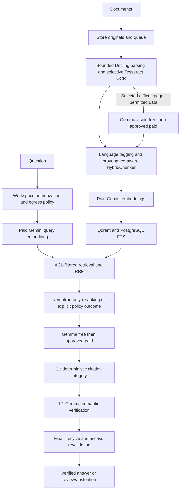

# Super RAG — Contabo and OpenRouter technical implementation plan

Prepared 2026-10-16. Status: implementation proposal; no production configuration, index or service changes made. Source: `RECOMMENDED_RAG_ARCHITECTURE_OPENROUTER.md`, inspected application code, runtime configuration, public OpenRouter catalogues and synthetic endpoint probes.

## 1. Controlling scope and latest decisions

The user's latest instructions take precedence over alternatives in the supplied document:

1. Run the application, storage, ingestion, retrieval and deterministic validation on Contabo. **No Spark dependency, service, tunnel or fallback.**
2. Keep **Google Gemini Embedding 2**, 3072 dimensions, through OpenRouter for document and query embeddings.
3. Use **Nemotron only for reranking**. Remove the supplied document's Cohere fallback from the implementation scope.
4. Use **Google Gemma 4 26B A4B IT** for generation through an explicitly approved free-first, paid-fallback route.
5. Implement **Stage 11: server-side deterministic citation integrity verification**.
6. Implement **Stage 12: Gemma semantic citation verification through OpenRouter free → paid**. Require a completed semantic verdict before serving a grounded `/ask` answer; keyword search is not an answer and needs no semantic generation call.
7. Use **OpenRouter Gemma free → approved paid for vision**, per the latest user correction, superseding the earlier paid-only instruction. Add image-content contracts and citable page/figure provenance before enabling it.
8. Deliver **V2 knowledge graph, V3 agents/research, V4 workflows and vision as enabled, end-to-end working capabilities** in the final deployment. They are required scope, not optional follow-ups. Intermediate feature flags may protect migration, but cannot count as final completion while these capabilities are off or unavailable.
9. Include **optional multimodal embeddings with Google Gemini Embedding 2**, through paid OpenRouter. This is an embedding capability, not a generative LLM stage, and remains separately feature-gated.

The previous Spark interface reference and Spark-targeted OCR proposal are historical context. This plan is the implementation proposal for the current requested deployment. Record accepted decisions additively in the controlling `../rag-fork-solution/DECISIONS.md`, reuse/license records and implementation tickets; do not silently rewrite frozen historical decisions or mark tasks complete.

“OpenRouter inference” here means embeddings, reranking, language generation and semantic verification. Tesseract, Lingua and the proposed TableFormer are local extraction/classification models, not generative LLM calls. Their artifacts still require origin and license checks.

## 2. Target stages

| Stage | Location | Implementation/model |
|---|---|---|
| 1. Collection | Contabo | Existing upload/web/S3/Git connectors |
| 2. Originals and versions | Contabo | SeaweedFS + PostgreSQL; checksum-verified immutable originals |
| 3. Parsing and tables | Contabo | Docling; optional standard PDF layout/TableFormer profile after resource/origin gates |
| 4. OCR | Contabo | Direct Tesseract 5; `ron+eng`, with `por` available for Portuguese documents |
| 5. Language identification | Contabo | Lingua; project-owned language metadata |
| 6. Chunking | Contabo | New Docling HybridChunker adapter, versioned and evaluated against existing chunkers |
| 7. Embeddings | OpenRouter, paid | `google/gemini-embedding-2`, 3072-d |
| 8. Retrieval | Contabo | ACL-filtered Qdrant + PostgreSQL FTS + RRF |
| 9. Reranking | OpenRouter | `nvidia/llama-nemotron-rerank-vl-1b-v2:free`; Nemotron only |
| 10. Generation | OpenRouter, free → paid | `google/gemma-4-26b-a4b-it:free` → `google/gemma-4-26b-a4b-it` |
| 11. Citation integrity | Contabo | Canonical chunk hydration, ACL/version/page/span/quotation checks |
| 12. Semantic citation verification | OpenRouter, free → paid | Same Gemma family; typed claim-support and contradiction verdicts |
| Vision extraction — required enabled capability | OpenRouter, free → approved paid | Gemma with image input; feeds citable ingestion evidence |
| Optional multimodal embeddings — no generative LLM | OpenRouter, paid | Google Gemini Embedding 2; typed image/figure and other admitted modality inputs |



## 3. Current baseline and exact gaps

| Area/file | Observed baseline | Implementation change |
|---|---|---|
| `packages/core/config.py` | Gemini embedding model/dimension already 3072 | Explicit extraction/embedding/routing profiles and validated typed settings |
| `docker-compose.yml` | `ANSWER_MODEL` defaults to Nemotron 3.5 Lightning; current runtime matches | Switch accepted generation policy to Gemma; retain infrastructure |
| `packages/models/adapters/openrouter_provider.py` | Unified chat/embedding surface, Gemma fallback and in-memory accounting | Enforced model/provider policy, bounded failure classification, durable accounting and request-specific privacy |
| Same provider | No provider allowlist in outgoing payloads; embedding request has no explicit dimension | Central payload builder for chat/embedding; freeze embedding configuration and check accepted request fields |
| Same provider | Broad exception retries and exhaustion heuristics | Retry only eligible errors; reject authentication/refusal/policy failures without paid escalation |
| `packages/rerank/openrouter_provider.py` | Optional Cohere v3.5 route; sync network call from async method; invented cost fallback | Nemotron-only async adapter; strict response mapping and actual/unknown costs |
| `packages/answer/factory.py` | Reranking opt-in; runtime flag absent; default extractive grounder | Wire resolved Nemotron policy and distinct Stage 11/12 interfaces |
| `packages/ingestion/adapters/docling.py` | Torch-free native PDF path, no TableFormer/layout models | Add explicit structured PDF profile; preserve native fast path |
| `apps/worker/jobs/ingest_pipeline.py` | Fully scanned PDFs parked before parsing | Conditional OCR path before terminal omission decision |
| `packages/ingestion/chunk.py` and LlamaIndex adapter | Section groups may cross pages; element metadata is not retained comprehensively | Source-span and page provenance contract; new HybridChunker backend |
| `packages/models/interfaces.py` | `ChatMessage.content: str` | Backward-compatible typed text/image content parts |
| `packages/answer/verification.py` | Canonical hydration and strict extractive grounding already exist | Preserve identity/access checks; add separately evaluated semantic support stage |
| Agents/graph/workflows | Mixed defaults and free-only gates in some code paths | One resolved Gemma policy including approved paid fallback, budgets and call-site accounting |
| Runtime | `GRAPH_MODE=off`, `CHUNKING_BACKEND=llamaindex` | Final graph target is `GRAPH_MODE=llm` with supervised extraction and retrieval; temporarily protect migration with flags |

The host currently has roughly 8 GB RAM and substantial swap use. A model-enabled Docling profile is not automatically suitable merely because inference APIs run remotely.

## 4. Provider policy and catalogue admission

Add project-owned `ModelRoute`, `ProviderPolicy`, `DataClass`, `Capability` and `ResolvedInferenceRequest` contracts. Resolve them from workspace policy before any data is serialized for transport. Provider policy is independently enforced for embeddings, reranking, generation, verification, graph, agents, workflows and vision.

Proposed files: `packages/models/policy.py`, `packages/models/catalog.py`, and `packages/models/adapters/openrouter_transport.py`. Reuse the existing httpx/provider surface; avoid adding a second model gateway or another agent framework. Keep vendor payloads inside adapters.

Every route records:

- Exact model slug, role, permitted free/paid behavior and model lineage evidence.
- Exact allowed provider/endpoint slugs, capability and region evidence, data handling, retention requirements and review date.
- Allowed modalities, structured-output/tool support, context limits and response validation.
- Time/attempt/output/monetary budget and degraded-result policy.

Build `provider.only` from an approved nonempty allowlist; `provider.order` alone is not a restriction. Apply `data_collection=deny`, ZDR and supported-parameter requirements where the resolved data policy requires them and the endpoint schema supports them. Never drop filters to make a failing request succeed. Check embeddings/rerank API behavior explicitly: chat documentation is not proof that every field is enforced on every endpoint.

Synthetic tests may pin Google AI Studio, Google Vertex or Cloudflare to avoid unrestricted routing. This is **not** production approval for confidential data, residency or ZDR. No provider is inferred safe from the model publisher's name.

Retain `local_only` as a hard egress veto. Since this deployment has no local embedding/generation fallback, local-only requests either use permitted keyword-only search or receive an explicit unavailable/policy response. Distinguish `cloud_approved_sensitive` from `local_only`; do not reinterpret existing sensitive workspaces automatically.

Catalogue admission is a deployment/startup check against public model/endpoints metadata, cached with timestamp and policy version. Readiness must not spend tokens. Missing/incompatible routes disable their capability with a typed diagnostic; base storage/auth health remains separately observable.

## 5. Routing, failures and budget ownership

Generation, semantic verification and vision each resolve their own eligible free/paid route. Public approved content can try free first. Confidential/personal content skips free unless that exact endpoint is explicitly approved for the data; paid does not itself mean privacy-compliant. Vision additionally requires image support from the selected provider on both tiers. Multimodal embeddings use the paid Gemini route without a free counterpart.

Use application-controlled model fallback, sending one explicit model per attempt. This permits refusal-aware and budget-aware behavior. Every attempt retains the same model-family, provider and privacy restrictions. Permitted workspace/request overrides can narrow approved routes, never widen them.

| Failure | Behavior |
|---|---|
| Free 429, timeout, 502/503/504 or no eligible free endpoint | Attempt approved paid Gemma within the original request deadline/budget |
| Explicit refusal, 401/403, disallowed model/provider/data, invalid request | No paid fallback; return typed refusal/configuration error |
| Insufficient balance/budget | Stop; do not disguise it as rate limiting or repeatedly retry |
| Malformed/truncated output | Reject; at most one bounded repair attempt using the same evidence and policy |
| Embedding outage | Bounded same-model retry on approved endpoints; never change embedding space |
| Nemotron rerank outage | Retry Nemotron within budget; explicit RRF-only degraded result or controlled failure |
| Stage 12 unavailable | `needs_review` or abstention; no verified grounded answer without a verdict |
| Stream fails after user-visible tokens | No blind restart/concatenation; send terminal failure or keep the draft unpublished |

Initial configurable limits: generation 90 s total; semantic verification 45 s total; rerank 15 s total; embedding batch 45 s total. Use separate connect/read/write/pool limits and bounded jittered backoff. Provisional generation/verification attempt cap: three total transport attempts including any paid transition or repair, subject to a stricter end-to-end deadline. Do not multiply retries in router, adapter, worker and client layers.

Reserve per-workspace spend transactionally before paid requests; reconcile with reported usage afterward. Track response/request IDs, served model/provider, tokens, cache usage, costs, attempt number, fallback reason and latency in durable storage. Missing cost is `unknown`, not zero; a reported zero is not replaced with an invented charge. Pending reservations from timed-out requests need later reconciliation because the upstream may have completed work.

## 6. Nemotron-only reranking

Replace the current Cohere-specific implementation with `NemotronRerankProvider` behind the existing `Reranker` interface. Update `packages/answer/factory.py`, retrieval traces, config and tests. Remove Cohere from active factories, fallback lists and policy registries for this deployment; historical source can remain only if explicitly unreachable and clearly marked.

Use `POST https://openrouter.ai/api/v1/rerank` with the exact admitted Nemotron slug. The public catalogue currently exposes a free NVIDIA endpoint; the unqualified paid slug returned an empty endpoint list during discovery. A paid Nemotron service is therefore **not assumed available**.

The NVIDIA free listing explicitly excludes confidential/personal data. For such content, this route is ineligible. With no verified approved paid Nemotron route, apply the configured no-rerank or stop policy. Do not use Cohere or another model to hide the gap.

Pass only ACL-filtered candidates. Initial candidate budget: top 40 fused candidates, return top 8, configurable and evaluated separately by language. Bound query/document lengths against the actual endpoint limits. Validate returned indices as unique, in-range integers and scores as finite numbers; reject malformed results. Preserve canonical chunk IDs, workspace/version metadata and extraction provenance when reordering. Do not treat scores as factual-confidence probabilities or compare scores across endpoint revisions without calibration.

Use a shared asynchronous httpx client rather than the current synchronous post inside an async method. Empty/error output is a typed failed rerank, not silent success. Trace `rerank_applied`, served identity and degradation reason.

## 7. Document parsing, TableFormer and OCR on Contabo

Retain the existing parser interfaces and accepted native fallback chain. Add a structured PDF profile using verified Docling layout and IBM TableFormer artifacts. TableFormer is a local neural table-structure model and needs CPU/RAM; it is not included in the current torch-free path.

Before changing dependencies, inventory the exact layout, table, OCR, tokenizer and preprocessing artifacts, license/base lineage and transitive packages. Do not blanket-approve “Docling”: optional OCR/layout choices can pull in different models. Pin artifact revisions/hashes in an asset manifest and download at image build time, not job execution.

Benchmark structured parsing in an isolated worker subprocess/container on the actual Contabo host. Start one CPU job at a time. Set a provisional 2 GiB child-memory ceiling and enforce a container cap with headroom for API/Postgres/Qdrant. Verify the chosen model actually fits; if it fails, retain the native profile with disclosed table limitations or increase Contabo capacity before enabling it. Never claim TableFormer support based solely on fixture tests of pdfplumber.

Add direct Tesseract `ron` and `eng` best models; package `por` for existing Portuguese support. Default Romanian/English jobs to `ron+eng`; choose additional languages from a validated hint/profile rather than always running three-language recognition. Renderer: pinned PDFium/pypdfium2 after license review. Avoid adding OCRmyPDF as an in-process dependency under the repository's permissive-library policy.

OCR goes after original checksum verification and bounded page inspection, before terminal `needs_review` decisions and chunking. Classify pages as native, scanned, blank or uncertain; handle nested image/Form XObjects and text-poor scans with page numbers. Render/OCR one page at a time in a killable child process group. Initial conservative host limits: 20 OCR pages/job, 15 megapixels/page, 45 s/page and 300 s/job, concurrency 1, Tesseract threads 1. These are pilot limits, not measured throughput.

Merge native/OCR content without duplicates in original page order. Keep original bytes immutable. Record engine/model/profile hashes, page coverage, text quality and geometric transforms. Convert pixel boxes through crop/rotation transforms into one documented original-page coordinate convention. Low-quality/uncertain pages remain disclosed; any partially read document retains review semantics. Store reports for zero-chunk results too.

Maintain Redis claim renewal and periodic worker heartbeat during long extraction. Current loop-level liveness writes are insufficient if the loop waits for a long job. Cancellation/timeout must terminate and reap renderer/Tesseract descendants; a Python thread timeout alone is not containment.

## 8. HybridChunker, tokenizer and evidence provenance

Add `packages/ingestion/adapters/docling_chunker.py`, selected by a new explicit backend value such as `docling_hybrid`; retain existing backends for comparison and rollback. Docling chunking is a library component, not a second retrieval framework.

HybridChunker operates on a Docling document structure, while the current parser returns normalized project elements. Introduce a project-owned `StructuredDocument`/`StructuredElement` contract containing source IDs, table rows/cells, headings and provenance. Inside the adapter, translate that representation into the Docling structure needed by HybridChunker. Vendor classes must not leak into orchestration. Store a versioned canonical extraction artifact for repeatable re-chunking; do not reconstruct tables from flattened text.

Configure an explicit tokenizer and max chunk size. HybridChunker's tokenizer must not trigger a runtime model download or silently use a default embedding model. Gemini's exact tokenizer availability must be verified; if a local approximation is used, label it, leave headroom, enforce byte/character limits and validate real embedding requests for non-truncation. Do not call whitespace counts exact Gemini token counts.

Initial experiment: 512 versus 768 target tokens with zero versus small overlap, paragraph/table-aware splitting and contextual heading prefixes. These are candidate configurations, not a production choice before RO/EN retrieval evaluation. Count contextual prefixes in embedding input limits. Repeat table headers in split table chunks and retain row/cell identity.

Chunks retain original document/version, page lists, section, source element/word IDs, text spans, boxes, OCR flags and parse limitations. Page-number citations must refer to the cited text, not the first page of a merged section. Prefer page-bounded chunks for OCR until multi-page span mapping is proven. Store citable text separately from the contextualized text sent for embedding.

## 9. Embedding contract and index migration

Keep `google/gemini-embedding-2` and 3072-d throughout this deployment. Query/document adapters share the same immutable embedding profile: model/version identity where exposed, dimensions, preprocessing, contextual serialization, task instructions if supported, normalization and metric. Do not copy Spark's `prompt_name` convention into Gemini requests without API support.

Validate batch count, index ordering, exact dimensions, finite/nonzero vectors and explicit model mismatch. Live responses used the short returned identity `gemini-embedding-2` for the requested `google/gemini-embedding-2`; permit only this explicitly recorded alias rather than rejecting the verified route or accepting arbitrary identities. No padding, truncation or alternate-model fallback. Reuse existing Qdrant collection only if its manifest proves the full embedding profile and source/chunk generation match. Matching dimensions alone do not establish compatibility.

Live discovery exposed an endpoint-specific constraint: a two-input batch was rejected under `google-vertex/eu` routing, but a single-input request passed. The two-input batch passed under `google-ai-studio`. Implement capability-aware batch splitting for an admitted Vertex-only profile, with bounded concurrency and preserved ordering. Do not silently switch to AI Studio when region/privacy policy requires Vertex. Provider equivalence and any task-prefix handling need dedicated embedding-space checks before enabling cross-provider failover; the smoke tests did not establish equivalence.

Generation and reranker changes alone need no re-embedding. Parser/OCR/HybridChunker changes create different source content/chunks and require a new publication generation across **PostgreSQL chunks/FTS and Qdrant**, not merely rewriting vectors.

Reuse `scripts/reindex_manifest.py`, `rebuild_with_manifest.py`, `audit_rebuilt_index.py` and `spotcheck_rebuilt_index.py` for frozen-source and vector audits where their contracts fit. Existing scripts rebuild from stored chunks; they are not automatically an original-document reparse/rechunk migration.

Add extraction profile, chunker profile and processing-generation identifiers. Build candidate chunks/FTS/vector state under an unpublished generation while the old generation serves. Readers and writers must select the same generation; Qdrant alias switch alone does not atomically switch PostgreSQL. Freeze or replay concurrent updates, fence deleted/superseded sources, audit candidate coverage, then switch one authoritative active-generation pointer and corresponding collection mapping. Invalidate cached evidence/context and derived graph artifacts for replaced chunks.

Preserve old manifests/collections for rollback. Rollback must restore the matching PostgreSQL generation and embedding/chunker profile, not just an alias. Extend the existing publication fences before enabling bulk reprocessing.

## 10. Stage 11 — deterministic citation integrity validator

**Mandatory. Runs on Contabo. Uses no LLM.** Reuse `packages/answer/verification.py`, `hydration.py` and existing store lookups; make the stage and its results explicit rather than replacing the existing validator wholesale.

Validate every candidate claim/citation against canonical records:

- Real chunk ID; caller's workspace access; real document and active source/processing version.
- Source not deleted/superseded; original-storage availability/checksum according to the existing storage contract.
- Valid page/section provenance and source spans; exact quotations match canonical source text at original offsets.
- Citation references correspond to the canonical evidence supplied to generation; graph summaries are routing hints, not primary evidence.
- Required citation markers cover factual claims; no fabricated pages, figures, links or IDs.
- Parsing/OCR omissions and uncertainty are attached to affected evidence and the answer.

Return typed `CitationIntegrityReport` with accepted/rejected references and reasons. Reject foreign/deleted/stale citations before invoking Stage 12. Missing markers are structural failures; marker presence is not semantic proof.

Separate identity/provenance checks from the current extractive-support heuristic. That heuristic rejects paraphrases/translations; running it destructively before Stage 12 would prevent semantic verification from evaluating them. Preserve it for the existing legacy profile and exact-quotation checks; introduce an explicit, tested semantic profile whose broader claims still require Stage 12 acceptance. No unreviewed relaxation of grounding.

## 11. Stage 12 — semantic citation verification with Gemma

**Mandatory for a grounded `/ask` answer. OpenRouter Gemma free → approved paid.** Add `packages/answer/semantic_verification.py` plus `packages/answer/adapters/gemma_semantic_verifier.py`. All calls use the central inference policy and their own `semantic_verification` call-site budget.

Input is a bounded set of atomic draft claims and Stage-11-approved canonical evidence. A new provider call evaluates support independently of the draft generation call. The same model family remains correlated with its own mistakes; the verdict is an additional safeguard, not proof of truth.

Require typed output per claim:

```json
{
  "claim_id": "c1",
  "verdict": "supported",
  "evidence_ids": ["real-chunk-id"],
  "support_spans": [{"evidence_id": "real-chunk-id", "start": 10, "end": 65}],
  "contradictions": [],
  "reason_code": "DIRECT_SUPPORT"
}
```

Allowed verdicts: `supported`, `partially_supported`, `unsupported`, `contradicted`, `uncertain`. Validate IDs and spans locally; require all input claim IDs exactly once and reject unknown extras. Model scores never override permissions, provenance or missing evidence. Validate numbers, dates, entities, negation and quoted versus asserted statements with dedicated RO/EN fixtures.

Supported claims may proceed. Partially supported claims may be narrowed once and rechecked; unsupported claims are removed or cause abstention, and contradictions are disclosed with both sources. Permit at most one controlled regeneration using the same approved evidence, then rerun both Stages 11 and 12 on the changed answer. If verification fails or cannot complete, return review/abstention, not a success badge.

Revalidate lifecycle/access immediately before final publication, because documents may be deleted during verification. No unverified draft tokens should be presented as the final answer: initially buffer generation and verification, while streaming progress events. A future provisional-draft UI requires explicit semantics and retraction handling.

Expose Stage 11 and Stage 12 outcomes separately in the answer/debugger contracts: structural integrity, semantic support, skipped/unavailable reason, limitations and served verifier model. Do not label an answer “verified” based only on the LLM declaring it supported.

## 12. Required vision free → paid and optional multimodal embeddings

Extend `ChatMessage.content` to preserve existing string messages while adding discriminated `TextContentPart` and `ImageContentPart` types. Use project-owned image assets containing document/version, page/figure ID, MIME, dimensions and checksum. Serialize to OpenRouter image blocks only inside the adapter.

Use bounded, selected page crops. Fetch source bytes through the authorized storage seam and encode controlled image data; do not let arbitrary user URLs become server-side fetches. Keep images within the workspace/data egress policy. Vision tries eligible free Gemma, then approved paid Gemma for bounded availability failures; use a separate image/token budget. Skip free when no approved image-capable endpoint is available for the data. No Spark fallback.

Vision extraction returns normalized elements or table cells with source references. Generated descriptions alone are not citable quotations. Retain rendered asset identity and validated page geometry; uncertain transcription remains reviewable. Preserve original Tesseract/native evidence alongside any model interpretation, and surface disagreement instead of silently “correcting” identifiers or amounts.

Enable vision only after transport tests, RO/EN page extraction, provenance, privacy and resource gates. Multimodal Gemini embeddings are a later separate feature: require a typed image/figure index and modality-compatible retrieval/reranking. Do not insert them into the text collection merely because dimensions match or assume text-only degraded handling is equivalent.

Optional multimodal embedding work includes project-owned input parts and source-asset references, verified OpenRouter Gemini modality serialization, explicit image/file/video/audio size limits for each admitted modality, an embedding-profile manifest, separate collection or named-vector configuration, and ACL/lifecycle-safe hydration of matched source assets. Begin with image/page embeddings; other modalities remain unsupported until tested. Evaluate text-to-image/image-to-image retrieval on human-labeled source pairs and verify original page/figure citations. No LLM-generated caption is required to call the embedding endpoint. Enabling this option must not change the existing text profile implicitly.

### Required additional layers: enablement and proof

| Layer | Final deployment state | Model route | Required live acceptance evidence |
|---|---|---|---|
| V2 knowledge graph | LLM extraction and graph retrieval enabled | Gemma free → approved paid | Upload a synthetic document; worker extracts real entities/relations through Gemma; persist them; retrieve through the graph leg; resolve answer citations to original canonical chunks |
| V3 agents/research | Real queued agent and research execution enabled | Gemma free → approved paid | Submit a task/research topic; supervised worker consumes it; planning, permitted evidence retrieval and synthesis complete; persisted result survives a process restart and retains verified citations |
| V4 workflows | Approved production workflows execute real model nodes | Gemma free → approved paid | Save/validate/approve a workflow; execute retrieval → LLM → verification/output; prove node outputs, provenance, persisted run/checkpoint and terminal state |
| Vision | Image transport and page/figure extraction enabled for permitted workspaces | Gemma free → approved paid | Upload a real synthetic page/figure through the product route; verify eligible free routing or bounded paid transition, actual image receipt, and searchable/citable extraction with original page/figure identity |
| Optional multimodal embeddings | Separately enabled for admitted image/page inputs | Paid Gemini Embedding 2; no generative LLM | Actual image input returns valid profile-compatible vectors; retrieval finds the correct authorized source asset and preserves its page/figure citation |

V2 changes: `packages/graph/dispatch.py` resolves `GRAPH_LLM_MODEL` to the shared Gemma route, and `packages/graph/communities.py` uses the same approved paid-fallback policy instead of assuming summaries must cost zero. Wire `GRAPH_MODE=llm` into API and worker, supervise `apps/worker/jobs/graph_extraction.py` via `apps/worker/worker/main.py`, and verify both processes share the same durable graph store. Rebuild graph references for the selected processing generation. Graph descriptions remain routing hints: hydrate real source chunks and apply Stages 11/12 to user-facing answers. Test workspace isolation and deletion of graph-derived results.

V3 changes: update `packages/agents/policy.py`, `planner.py`, `factories.py`, `research_pipeline.py`, `runtime.py` and the agent/research HTTP factories to resolve Gemma consistently. Replace free-only module gates with the explicit approved free/paid route and workspace budget checks, without widening permitted tools or removing approval boundaries. Ensure the supervised agent consumer is running and durable run/step storage is shared between API and worker. Research reports and factual agent outputs must use the same canonical citations and Stage 11/12 verdicts as `/ask`; verify retries/cancellation and no duplicate side effects. Separate external web research permissions from access to workspace documents.

V4 changes: ensure `packages/workflow_engine/production_executor.py` and `apps/api/app/workflows/router.py` construct the real provider/executor and durable draft/run/approval/checkpoint stores. LLM nodes inherit the resolved Gemma route; a node override must be admitted by the same model/provider policy. Route evidence-bearing outputs through the common Stage 11/12 verification service, rather than treating successful text generation as verified output. Preserve workflow validation, explicit approval rules, connector permissions, bounded execution and recovery from checkpoints.

Expose separate readiness and effective enabled status for graph extraction/retrieval, agent execution, research execution, workflow execution and vision transport. A UI menu, an environment flag, a registered factory or a direct model smoke test alone is not enablement evidence. Each layer must have a recorded product-level run with served model/provider identity and actual output. Report unavailable/degraded capabilities explicitly; do not silently substitute stub/rule execution for configured LLM execution.

The user's latest instruction requires the full V2/V3/V4/vision end state and supersedes earlier scope deferral of these layers for this plan. Sequence implementation according to prerequisites; retain per-workspace authorization, rollout controls and coordinator-owned deployment review. This document update does not itself toggle live services or establish that their end-to-end tests have passed.

## 13. API, persistence and operational changes

Proposed durable records: inference attempts/usage, policy and asset manifests, extraction reports, processing generations, verification runs/claim verdicts and paid budget reservations. Use new Alembic revisions; do not edit applied migrations. Verify whether existing tables can supply the required fields before creating overlapping stores.

Update `packages/ingestion/persistence.py`, `apps/api/app/documents/upload.py` and `reads.py` for extraction reports/progress; `packages/answer/models.py`, `apps/api/app/ask/router.py`, frontend ask contracts and citation UI for separate verification outcomes. Additive fields first; version any breaking enum/status changes.

Update `.env.example`, `packages/core/config.py` and Compose with typed settings for provider policy path, exact model routes, stage deadlines, candidate limits, OCR/structured-parser/chunker flags and semantic/vision switches. Keep one OpenRouter secret source and never return credentials/provider exception payloads to the browser.

Package local extraction assets in the worker image only where possible. Avoid loading TableFormer/Tesseract in the API process. Maintain separate capability readiness for extraction, embeddings, reranking, generation and semantic verification; synthetic paid health calls are operator-triggered, not repeated readiness probes.

Track content-free metrics by stage/workspace: OCR pages and review rate, extraction latency/RSS, embedding batches/tokens, retrieval recall, rerank use/degradation, free/paid attempts, spend, Stage-11 rejection reasons, Stage-12 verdicts/latency, abstention and citation lifecycle races. Store necessary verification evidence under existing ACL/retention rules; do not log full document text or images.

## 14. Implementation packages and dependencies

| Package | Scope and principal files | Completion evidence |
|---|---|---|
| OR-01 | Catalogue/provider policy, model-lineage manifest, configuration; `models/policy.py`, `catalog.py`, origin guard | Only admitted model/provider/role combinations serialize; empty allowlist fails closed |
| OR-02 | Shared OpenRouter transport/fallback, async rerank transport, durable cost/budget ledger | Refusal/auth never triggers paid escalation; every attempt accounted; unknown cost distinguished |
| OR-03 | Gemma defaults across ask, agents, graph and workflows; remove active unrelated models | Every generative call resolves centrally; existing free-only module assumptions reconciled |
| OR-04 | Nemotron-only adapter and factory/trace integration | Real RO/EN rerank response mapping; no Cohere calls; confidential-route behavior proven |
| OR-05 | Explicit Stage 11 report and canonical evidence contract | Foreign, deleted, superseded, bad-page/span/quotation references rejected |
| OR-06 | Stage 12 Gemma verifier, bounded correction and final publication gate | Supported/unsupported/contradicted RO/EN cases; verifier failure never emits verified answer |
| OR-07 | Tesseract, extraction reports, child budgets and worker liveness | Real raster RO/EN text, geometry, partial disclosure and timeout/cancel tests |
| OR-08 | Docling layout/TableFormer resource/origin spike and structured representation | Real structured tables within measured Contabo budget; no hidden unapproved models |
| OR-09 | HybridChunker adapter, tokenizer policy and source spans | Offline assets, table/page provenance, paired retrieval evaluation |
| OR-10 | Processing-generation schema, candidate rebuild, atomic serving selection and rollback | Frozen-source audit across chunks/FTS/vectors; delete/supersession race tests |
| OR-11 | Typed image messages and vision free → paid adapter | Real image-input tests, provider/data eligibility, bounded fallback and page/figure citation mapping |
| OR-12 | API/UI/debugger, metrics, end-to-end acceptance and canary | Both verification stages visible; core acceptance and rollback proof |
| OR-13 | Enable V2 extraction/retrieval, shared graph store and Gemma community summaries | Real graph extraction → graph retrieval → source-cited answer; isolation/delete/restart checks |
| OR-14 | Enable V3 queued agents and research using durable stores and shared verification | Real task and research report with Gemma, citations, restart/cancellation proof |
| OR-15 | Enable V4 production workflow execution and verified evidence-bearing outputs | Approved workflow executes actual retrieval/model/verification nodes and resumes from checkpoint |
| OR-16 (optional) | Gemini multimodal embedding adapter, asset/vector profile and retrieval | Real image/page embeddings and authorized asset retrieval/citations; separate text-index compatibility checks |

Sequence: OR-01 → OR-02 → OR-03/04 → OR-05 → OR-06 for the existing text index; OR-07/08 → OR-09 → OR-10 for improved ingestion; OR-11 follows provenance and policy contracts. OR-13 follows canonical-source verification and processing-generation contracts; OR-14 follows shared routing/budgets, canonical retrieval and durable workers; OR-15 follows workflow/runtime contracts and shared verification. OR-12 integrates each accepted slice. Final acceptance requires OR-11 and OR-13/14/15 enabled and proven end to end; core RAG alone is not the completed requested deployment.

Planning estimate: 4–6 engineering weeks for the core architecture, plus approximately 1–2 weeks to complete the required additional-layer wiring and acceptance, subject to the existing implementation's condition. Add corpus review/provider admission and any required Contabo capacity change. The text-routing/rerank/verification slice can land before parser/chunker/index migration. Estimates are provisional; no implementation tickets are marked complete by this document.

## 15. Test and release gates

Keep unit/contract tests offline using mock transports for policy and error cases. Add opt-in synthetic live tests for free/paid generation, semantic verification, paid embeddings, Nemotron reranking and paid image input. Never rely on fake responses as evidence of real model quality or provider-policy enforcement.

Required coverage:

- Public, cloud-approved sensitive and local-only policies on every call site; provider/model refusal, credentials, 429/5xx/timeouts, exhausted budget and malformed output.
- Free → paid transitions preserve the exact provider/privacy constraints; no accidental model-family switch, no Cohere fallback and no duplicate stream publication.
- Stage 11 canonical access/version/page/span/quotation and mid-request delete/supersession races.
- Stage 12 supported/partial/unsupported/contradicted/uncertain claims, RO/EN cross-language evidence, changed quantities/entities, negation, attribution and evidence injection.
- Native, scanned, mixed and table-heavy documents; Unicode diacritics; real OCR; bounded geometry and subprocess cancellation; durable zero-chunk reports.
- HybridChunker text/table/heading/page coverage and vector profile compatibility; no silent truncation or runtime model downloads.
- Real V2 graph extraction/retrieval, V3 queued agents/research, V4 approved workflow execution and vision free → paid through product routes, with durable outputs, original-source citations, Stages 11/12 where applicable and no stub execution.
- Paired old/new retrieval and answer evaluation on frozen RO/EN corpus. Report recall@20, nDCG, factual precision, citation correctness, correct abstention, review rate, p50/p95 latency and cost per successful answer.

Reuse the controlling five acceptance probes: grounded answer/correct original-page citation, ACL isolation, delete propagation, fabricated-citation rejection and multilingual retrieval. Retain existing quality targets from the controlling plan and ratify measured corpus thresholds before promotion. Semantic-verifier accuracy must be scored against human labels, not the verifier's own score.

Release in slices: policy/transport with old index → Gemma + Nemotron pilot → mandatory Stage 11/12 pilot → isolated new extraction/chunking generation → audited index switch → vision free → paid → proven V2 graph, V3 agents/research and V4 workflows. Their order may follow the dependency graph, but all four additional layers must be enabled in the accepted final deployment. Optional multimodal embeddings follow their own asset/index acceptance. Preserve source manifests and configuration for rollback. Disable new paid calls/ingestion on budget or resource breach; do not pretend a feature-flag flip restores old chunks or an old index.

Production enablement requires exact provider allowlists and verified data terms, proven Nemotron eligibility/degradation policy, TableFormer resource evidence if enabled, index-generation compatibility, passing citation/ACL tests and coordinator-owned deployment review. This plan does not request immediate deployment or modify live service settings.

## 16. Discovery and live-test evidence

Public catalogue checks on 2026-10-16 confirmed Gemma free/paid and Gemini Embedding 2 model entries. Gemini lists 8192 context tokens and multimodal inputs; application support still requires separate contracts. Catalogue Gemma free is served by Google AI Studio; paid lists multiple providers, including providers that must not be selected unrestrictedly under the no-China requirement.

Discovery for `nvidia/llama-nemotron-rerank-vl-1b-v2:free` returned an NVIDIA endpoint. Discovery for the unqualified paid slug returned no endpoints. No free Gemini Embedding 2 route is assumed. Do not invent free/paid counterparts from naming conventions.

Synthetic live results are recorded in `docs/evidence/openrouter-model-smoke-2026-10-16.json` and `openrouter-model-smoke-followup-2026-10-16.json`; the companion `OPENROUTER-MODEL-TEST-REPORT-2026-10-16.md` records interpretation. Catalogue snapshots are in `openrouter-catalogue-2026-10-16.json`.

Verified results: Nemotron free reranking passed; paid Gemma RO/EN generation, semantic verification and image input passed through CoreWeave; paid Gemini 3072-d batch embeddings passed through Google AI Studio, and a single embedding passed through the requested Vertex EU endpoint. Free Gemma generation and verification returned upstream 429 in both runs. Cloudflare paid text calls returned 429 and that provider was excluded by image-support routing. These are route-specific observations, not conclusions about every provider.

Production implications: paid Gemma must be available for both generation and Stage 12 when the free shared pool is exhausted; vision needs an image-capable provider allowlist distinct from text-only endpoints; Vertex embedding batch size must be constrained. Successful API smoke calls establish only those payloads and routes at that time, not production quality, privacy compliance, throughput, residency evidence or SLA.

The subsequent vision routing correction does not change historical test results: only paid vision was tested in that run. Free vision availability/fallback and actual Gemini image embeddings still need dedicated tests; the successful Gemini tests used text inputs only.

## 17. Primary references

- [OpenRouter provider selection and privacy filters](https://openrouter.ai/docs/guides/routing/provider-selection)
- [OpenRouter RAG embeddings/reranking example](https://openrouter.ai/docs/cookbook/evaluate-and-optimize/rag)
- [Gemma free catalogue](https://openrouter.ai/google/gemma-4-26b-a4b-it:free)
- [Gemma paid catalogue](https://openrouter.ai/google/gemma-4-26b-a4b-it)
- [Gemini Embedding 2 catalogue](https://openrouter.ai/google/gemini-embedding-2)
- [Nemotron reranker and free-endpoint data restrictions](https://openrouter.ai/nvidia/llama-nemotron-rerank-vl-1b-v2:free)
- [Docling HybridChunker concepts](https://docling-project.github.io/docling/concepts/chunking/)
- [Docling model assets and license](https://huggingface.co/docling-project/docling-models)
- [Tesseract official engine and model history](https://github.com/tesseract-ocr/tesseract)
- [Tesseract official traineddata](https://github.com/tesseract-ocr/tessdata_best)

The supplied architecture document remains unchanged as source material. Its Cohere fallback and optional Spark references are overridden by the user's subsequent instructions recorded in Section 1.
