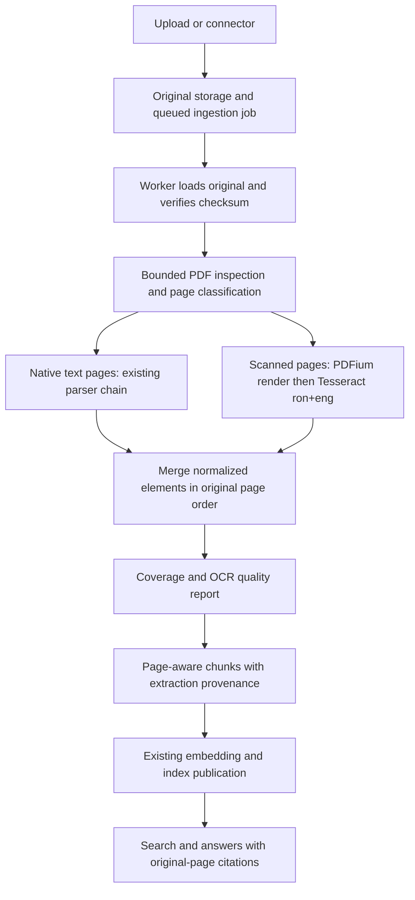

# Romanian and English OCR integration plan

Prepared 2026-10-16 from the Contabo workspace and running API/worker configuration. Status: proposal; no runtime changes or deployment performed. Target: local OCR on DGX Spark 128 GB. The Spark itself has not been inspected.

## 1. Placement and architecture

Add OCR to the asynchronous ingestion worker, after original-byte checksum verification and PDF inspection, before normalization, chunking, embeddings and index writes. Keep engine and renderer calls behind `packages/ingestion/adapters/`. OCR is an extraction capability, separate from the answer LLM and model router.



Recommended implementation: Tesseract 5 CLI, official `tessdata_best` Romanian (`ron`) and English (`eng`) files, plus PDFium through pypdfium2 for rendering. Use local subprocesses, not a public OCR HTTP endpoint. This reuses extraction engines and builds only routing, normalization, provenance and job integration.

Adjustment to the earlier recommendation: OCRmyPDF is MPL-2.0, whereas this repository restricts in-process/library reuse to permissive dependencies and treats copyleft components as service-only. Direct Tesseract avoids introducing OCRmyPDF into the application. A searchable-PDF export service can be considered separately; it is not required to index scans.

## 2. Verified current behavior and gaps

| Existing component | Current behavior | Required change |
|---|---|---|
| `apps/worker/jobs/ingest_pipeline.py:process_job` | Loads original bytes; rejects unsupported MIME; parks fully scanned PDFs before parsing | Invoke conditional OCR before deciding which content remains unreadable |
| `packages/ingestion/adapters/pdf_scan.py` | Detects text and direct image XObjects; any nonempty text counts as readable | Bounded inspection; include nested Form XObjects, text quality and explicit uncertain cases |
| `packages/ingestion/adapters/docling.py` | Native, model-free PDF pipeline | Keep native parser for readable pages; do not implicitly enable Docling's ML stack |
| `packages/ingestion/adapters/registry.py` | Docling → pypdf → pdfplumber precedence | Preserve native precedence; add a page-routing wrapper outside that fallback chain |
| `packages/ingestion/interfaces.py` | Normalized elements support page, bbox and metadata | Add project-owned OCR request/result contracts, without vendor types |
| `packages/ingestion/chunk.py` | Groups by section; may combine pages; drops arbitrary element metadata | Split OCR-bearing documents by page and section; preserve source spans and extraction metadata |
| `packages/ingestion/adapters/llamaindex_chunker.py` | Shares built-in section/group assembly | Apply the same provenance contract to both chunkers |
| `packages/ingestion/metadata.py` | Supports `ro`, `pt`, `en`; trusts a declared parser language | Determine OCR output language from text; do not declare `ro` merely because `ron` was requested |
| `packages/ingestion/persistence.py` | Chunk JSON metadata exists; job has no structured extraction report | Add durable job extraction report and processing-profile snapshot |
| `apps/api/app/documents/upload.py` | Job poll exposes status/error only; identical ready upload skips parsing | Expose additive extraction summary; handle OCR reprocessing explicitly |
| `packages/answer/engine.py` | Discloses omitted pages through chunk metadata | Extend wording to OCR omissions/quality; current text says every omission had no text layer |

The checked-in scan fixtures test unreadability/disclosure. Their existence does not establish real Romanian or English OCR accuracy. Add actual readable raster-text fixtures.

## 3. Scope and page-routing rules

First release: printed Romanian and English PDFs, including documents with both native and scanned pages. Enable PNG/JPEG ingestion in a separate follow-up using the same engine, with explicit MIME, pixel and frame limits. XLSX and handwriting remain separate capabilities.

Classify each PDF page as `native_text`, `ocr_required`, `blank`, or `uncertain`. Whitespace-only extraction is not evidence of readability, and one page-number string must not make a scanned page look fully readable.

1. Inspect pages under a deadline and page/geometry limits. Consider text density, invalid characters, image coverage and extraction errors. Evaluate these signals against the corpus rather than claiming a universal threshold.
2. Parse native content using accepted precedence. For mixed documents, filter native results to their corresponding native pages. If page attribution is absent, refuse the merge rather than duplicate unlocated text.
3. Render OCR-required pages at 300 DPI initially, reducing resolution or refusing oversized output according to the pixel cap. Render one page at a time.
4. Run Tesseract with `-l ron+eng --oem 1`; benchmark page segmentation modes 3 and 6. Choose one default profile; do not retry every mode on every page.
5. Read TSV output for recognized words, geometry and confidence. Group into normalized line/block elements without treating whitespace as table structure.
6. Merge native and OCR elements by original page and reading order. Native and OCR output must not both publish the same region.
7. Record unresolved/uncertain pages and publish according to the outcome table below.

Pages containing meaningful native text plus additional scanned text regions require region-aware handling. Initial automatic support must not claim completeness for those pages: detect suspicious image coverage, disclose uncertainty and send to review. A later region OCR pass may resolve them after deduplication is proven. Figures and logos must not trigger OCR solely because an image exists.

Reuse PDFium's rendering transforms and existing parser adapters. Do not implement a new PDF renderer, OCR recognizer or general layout model.

## 4. Adapter contracts and files

New proposed files:

| File | Responsibility |
|---|---|
| `packages/ingestion/ocr.py` | Project-owned routing and merge orchestration, profile resolution and outcome classification |
| `packages/ingestion/adapters/tesseract.py` | CLI invocation, model verification, TSV conversion to project-owned OCR results |
| `packages/ingestion/adapters/pdfium_render.py` | PDFium inspection/rendering; page geometry and pixel-to-original-coordinate transforms |
| `apps/worker/jobs/ocr_subprocess.py` | Child-process entry point for bounded render/OCR work; imports adapters |
| `infrastructure/ocr/models.lock.json` | Exact official model revision, SHA-256, license and source for `ron`/`eng` |
| `scripts/verify_ocr_assets.py` | Build/startup asset verification; no runtime downloads |
| `tests/fixtures/ocr/` | Real raster-text PDFs/images, ground truth and geometry cases |
| `evals/ocr_ro_en.py` | Reproducible OCR accuracy, extraction coverage and retrieval evaluation |

Define `OcrPageRequest`, `OcrPageResult`, `OcrWord` and `ExtractionReport` in `packages/ingestion/interfaces.py` (names provisional). Results must include original page index, text, boxes, engine/version, model hashes, processing profile and quality flags. No PDFium, Tesseract or Pillow objects leave adapters.

Keep the native parser report (`parse.primary`, `parse.used`, fallback attempts) distinct from OCR provenance. Intentional OCR routing is not a native parser failure and must not be reported as an undisclosed parser fallback.

## 5. Provenance, citations and language

Each OCR element carries `extraction_method=tesseract`, original page number, stable element ID, original-coordinate bbox and OCR confidence summary. Store one explicit coordinate convention (PDF points, top-left origin) and the transform from rendered pixels, including crop box and page rotation. Verify alignment against the original viewer. If deskew/orientation correction is introduced, compose its inverse transform too.

Do not rewrite originals or their SHA-256. Initial indexing needs extracted text and geometry, not a replacement PDF. Any later derivative PDF must use a separate object key, recorded checksum and lifecycle.

For OCR-bearing documents, prevent chunks from crossing page boundaries. Preserve ordered source element/word references and chunk text spans through whitespace normalization and sentence splitting in both chunkers. One union bbox cannot accurately identify disconnected text regions: retain a list of boxes where needed. Keep OCR metadata on the exact chunks it describes.

Proposed metadata shape:

```json
{
  "extraction": {
    "method": "tesseract",
    "engine_version": "<pinned version>",
    "profile_hash": "<sha256>",
    "requested_languages": ["ron", "eng"],
    "page": 3,
    "quality": "accepted",
    "source_spans": [
      {"element_id": "p3-b1-l1", "start": 0, "end": 24,
       "bbox": [72, 90, 280, 105]}
    ]
  }
}
```

Full model hashes belong in the durable report; chunks can reference its profile hash. Tesseract confidence is a recognition score, not a calibrated probability of correctness. Never translate it directly into answer confidence.

Use existing text language detection with OCR outputs; check Romanian without diacritics as well as `ă â î ș ț`. Preserve original transcription with Unicode NFC normalization; any cedilla/comma compatibility normalization should be a documented search normalization, not a silent alteration of source evidence. Use document dominant language initially and retain page language in metadata for mixed documents.

## 6. Outcomes, reporting and UI

| Outcome | Publication and status |
|---|---|
| Every relevant page extracted and quality checks passed | Index chunks; `ready`, with OCR provenance |
| Some pages unreadable, uncertain or below quality threshold | Index accepted content only; `needs_review`, with named page limitations on every published chunk |
| No acceptable text extracted | Publish zero chunks; `needs_review` |
| OCR disabled or unavailable | Preserve current honest omission behavior; show capability reason |
| Malformed/encrypted unsupported PDF | Typed non-retryable refusal |
| Page/pixel/time/memory budget exceeded | Terminate subprocess; typed budget outcome; no false `ready` |
| Transient worker/broker/storage failure | Existing bounded retry policy |

Use the existing canonical error registry in `packages/core/errors.py`; add agreed codes rather than opaque exception strings. Exact engine/model details belong in diagnostics, not product-facing error messages.

Add a JSONB extraction report and frozen processing profile to ingestion jobs via a new Alembic migration. Persist reports for zero-chunk outcomes too; logs alone are not durable job disclosure. Report native/OCR/blank/uncertain/failed page counts, affected pages, elapsed time and profile hash.

Expose report summaries through the job poll in `apps/api/app/documents/upload.py` and document/job reads in `apps/api/app/documents/reads.py`. Keep top-level stage `parsing` for initial compatibility and add extraction progress fields. If a distinct `ocr` stage is later added, update every API/UI enum and contract together.

Show “Reading scanned pages”, “Text extracted from scan”, and “Pages requiring review” in the document detail and citation UI. Extend `packages/answer/engine.py` to disclose unreadable and low-quality OCR regions accurately. Engine presence alone must not downgrade an accepted source; uncertain extraction must cap confidence and preserve the existing review semantics.

## 7. Process limits and worker liveness

Run PDF rendering and Tesseract in a killable child process group. Do not rely on the existing parse thread-pool timeout: it cannot stop native code or account for subprocess RSS. Use async subprocess waits so Redis lease renewal can continue. Kill descendants on cancellation/deadline and reap them before the slot is reused.

Provisional Spark pilot defaults, to be tuned with measured pages:

| Setting | Initial value |
|---|---|
| `OCR_ENABLED` | `false` until pilot; enable on Spark explicitly |
| `OCR_LANGUAGES` | `ron+eng` |
| `OCR_MODEL_SET` | `best` |
| `OCR_RENDER_DPI` | `300` |
| `OCR_MAX_DOCUMENT_PAGES` | `200` total pages |
| `OCR_MAX_PAGES` | `50` OCR pages per job |
| `OCR_MAX_PAGE_PIXELS` | `25,000,000` |
| `OCR_PAGE_TIMEOUT_SECONDS` | `60` including page rendering |
| `OCR_DOCUMENT_TIMEOUT_SECONDS` | `600` |
| `OCR_MAX_CONCURRENT_JOBS` | `1` initially, then benchmark `2` |
| Tesseract `OMP_THREAD_LIMIT` | `2` per process |
| OCR child memory / temporary output | `2 GiB` / `1 GiB` per job |

These values are proposed operating limits, not measured Spark performance. Enforce limits before allocating raster buffers, and enforce aggregate container limits in addition to child limits. Keep existing normalized-text/element budgets; add an explicit combined extraction deadline instead of silently letting OCR escape the 120-second native parse budget.

Inspect `apps/worker/jobs/ingest_worker.py` liveness carefully: it writes heartbeat on loop iterations, which may be too infrequent during a long job. Maintain a periodic heartbeat while a job runs, separately from claim renewal. Test loss of lease, process cancellation and shutdown during OCR. Long-running OCR must not make `/ready` falsely report a dead worker or permit a stale attempt to publish.

## 8. DGX Spark deployment

Install engine and traineddata in the worker image, not the web/API images. Update `apps/worker/Dockerfile`, worker requirements, `.env.example` and Compose worker settings. Pin the base image, package versions and model hashes; verify Linux ARM64 binaries/wheels on the actual Spark. Copy models into the image at build time and operate offline afterward.

Start with the ingestion worker colocated with the document store/queue on the Spark deployment. Tesseract uses CPU; no GPU reservation is required. Existing embeddings and generation currently use OpenRouter, so local OCR does not make the entire application local.

If the rest of the stack remains on Contabo, provision authenticated private connectivity for a dedicated Spark ingestion worker and its queue/storage access; do not expose Redis/Postgres/object storage publicly. Queue routing must ensure OCR-enabled jobs reach that worker. Treat this split-host topology as a separate deployment task because no Spark connectivity or credentials were checked here.

An optional later local OCR service is reasonable if independent scaling is needed. It is not the first implementation: a worker subprocess requires fewer new interfaces and avoids an extra page-upload network hop.

## 9. Model origin and dependency records

Record Tesseract, official `ron`/`eng` traineddata, renderer and transitive binary notices in `../rag-fork-solution/DECISIONS.md`, `REUSE_MAP.md`, and the applicable license/notice documents. Keep historical frozen decisions intact; add a new OCR decision.

Extend verification beyond `scripts/model_origin_guard.sh`'s current reranker-focused checks: allow only pinned OCR model assets, validate hashes, and reject runtime model resolution/downloads. The requested policy covers project and base-model lineage; it does not prove that every training sample or contributor came from a particular country.

No Qwen-, DeepSeek- or Paddle-based OCR fallback. LightOnOCR-2 and olmOCR-2 do not satisfy this policy. Keep the rendering path free of optional model-backed preprocessors unless separately vetted.

## 10. Reprocessing and safe rollout

Freeze the OCR profile when a job is queued so retries cannot change models/settings midway. Use the original checksum plus profile hash when deciding whether an old extraction can be reused. Identical ready uploads currently bypass parsing, so enabling OCR cannot automatically repair existing documents.

First pilot only new uploads in a test workspace. Then support an authenticated, workspace-scoped reprocess action. Initially allow only eligible `needs_review`/failed sources under an exclusive per-version processing fence. Mixed-scan jobs may already have chunks: build a candidate publication generation and replace old chunk/FTS/vector state atomically through the project's publication discipline. Do not blindly re-enqueue and append to partially indexed documents.

If existing version/claim fences cannot distinguish old and candidate processing attempts, add an explicit processing-generation identifier before enabling backfill. Audit stable IDs, graph references, delete propagation and supersession for that identifier. Do not weaken source-checksum dedup globally to solve this problem.

Rollout order: flag off → isolated Spark corpus evaluation → one pilot workspace → bounded review-document backfill → enable new-upload OCR more broadly. Keep a manifest of affected document versions and processing profiles. Rollback stops new OCR jobs and cancels running child processes; already-published OCR chunks require explicit restoration/reprocessing and are not removed by a flag flip.

## 11. Verification and acceptance

Use real Tesseract and the pinned renderer for extraction acceptance; fake subprocesses are suitable only for orchestration/failure unit tests. Test clean/noisy Romanian and English, mixed languages, mixed native/scanned pages, blank pages, rotation, crop boxes, nested images, small fonts, multicolumn text and tables. Include corrupted PDFs, oversized pages, missing traineddata, timeouts and cancellation.

Suggested corpus: 100+ representative pages, including at least 30 Romanian, 30 English, 20 mixed-language or mixed-extraction pages and difficult cases. Categories may overlap. Use human-verified transcriptions and field values; add critical names, dates, totals and identifiers.

Proposed acceptance targets, to ratify against the actual documents:

- Clean printed RO and EN character error rate ≤2% separately; report difficult scans separately.
- Zero confidently published unreadable regions; every page has a recorded outcome.
- 100% tested citations resolve to the correct original document/page; geometry mapping passes rotation/crop tests.
- Exact critical fields on the golden set or an explicit review outcome; low overall character error must not conceal wrong amounts or identifiers.
- No duplicate native/OCR text, no cross-workspace leakage, no stale publication after deletion/supersession.
- No orphan OCR processes after timeout/cancellation; lease and heartbeat remain healthy under long jobs.
- Search/answer golden questions retrieve OCR-only facts in both languages and cite their original pages.
- OCR-off regression tests preserve existing digital-PDF behavior; both chunking backends preserve OCR provenance when enabled.

Report seconds/page p50/p95, peak child/container memory, queue latency, review rate and extraction failures on the Spark. Do not extrapolate GPU model benchmarks to Tesseract throughput.

Run focused unit/contract/integration tests, repository lint/type checks and the five controlling acceptance probes. Update `FORMAT-MATRIX.md` and its code/tests only when scanned-PDF support is proven; classify uncertain layouts honestly instead of advertising every scan as fully supported.

## 12. Implementation work packages

| Order | Work package | Completion evidence |
|---|---|---|
| 1 | Dependency/origin decision, fixture corpus and ARM64 spike | Pinned models/render stack work offline on Spark; baseline RO/EN results |
| 2 | OCR contracts, renderer and killable Tesseract adapter | Real raster text extraction; geometry; process/budget tests |
| 3 | Bounded page inspection, native/OCR merge and coverage | Mixed PDFs read once, in original order, with explicit omitted regions |
| 4 | Page-aware chunk provenance and language handling | Both chunkers retain correct spans/boxes; Romanian citations proven |
| 5 | Worker wiring, durable job reports, liveness and API/UI | Long OCR job stays live; zero-chunk disclosures survive restarts |
| 6 | End-to-end evaluation and staged Spark deployment | Corpus targets, retrieval/citation/ACL probes, measured resource settings |
| 7 | Fenced reprocessing and bounded backfill | No stale/duplicate chunks; rollback and delete/supersession proof |
| Later | PNG/JPEG ingestion and optional vision fallback | Separate format and local-model acceptance evidence |

Planning estimate: roughly 8–13 engineering days for work packages 1–6, plus 2–4 days for safe reprocessing, assuming representative documents and Spark access are available. These are estimates; difficult layouts or publication-generation changes can increase scope. Coordinator retains merge/deployment ownership under the existing repository protocol.

## 13. Existing vision capability and optional extension

The code has Google Gemma 4 26B A4B free/paid routing through OpenRouter. Google's model supports image input, but `packages/models/interfaces.py:ChatMessage.content` is a string and the current generation path does not accept page images. The running Contabo API/worker `ANSWER_MODEL` is `nvidia/nemotron-3.5-lightning:free`; no local vision container was observed. Do not describe Gemma vision as an active document-ingestion feature.

A later local Gemma vision adapter on Spark could inspect selected low-quality pages or complex tables. It requires image-content contracts, a local ARM64/Blackwell serving spike, RO/EN evaluation, model-license/origin review and retained page provenance. No automatic OpenRouter fallback for local OCR. VLM output must not silently “correct” names/numbers or replace original OCR evidence; disagreements become review signals. This extension is not required for the Tesseract first release.

## Sources checked

- [Tesseract history and license](https://github.com/tesseract-ocr/tesseract)
- [Official Romanian/English language support](https://tesseract-ocr.github.io/tessdoc/Data-Files-in-different-versions.html)
- [Official best traineddata](https://github.com/tesseract-ocr/tessdata_best)
- [Tesseract image quality and segmentation guidance](https://tesseract-ocr.github.io/tessdoc/ImproveQuality.html)
- [pypdfium2 platform and license documentation](https://github.com/pypdfium2-team/pypdfium2)
- [OCRmyPDF license](https://github.com/ocrmypdf/OCRmyPDF/blob/main/LICENSE)
- [LightOnOCR model initialization and teacher provenance](https://arxiv.org/html/2601.14251v1)
- [olmOCR-2 base model](https://huggingface.co/allenai/olmOCR-2-7B-1025)
- [Google Gemma 4 model card](https://huggingface.co/google/gemma-4-26B-A4B-it)
- [NVIDIA Spark specifications](https://docs.nvidia.com/dgx/dgx-spark/system-overview.html)
