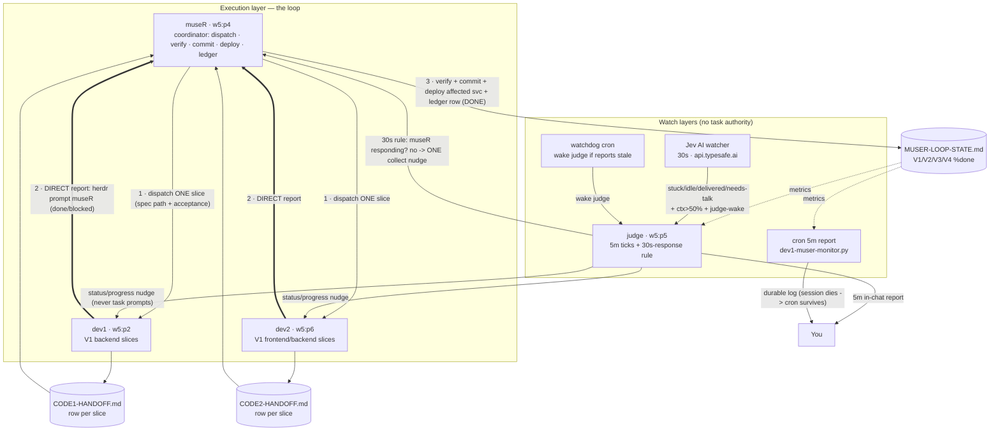

# Agent Coordination Flow — dev1-museR loop (2026-10-12)

> Monitored + documented by **judge** (`w5:p5`). Authority reminder: **museR is the only agent that accepts, commits, deploys, and writes the ledger.** This diagram is read-only documentation.

## Diagram (Mermaid)

## Layer responsibilities

| Layer | Cadence | Authority | Actions |
|---|---|---|---|
| museR | per delivery | **sole**: dispatch, accept, commit, deploy, ledger | collect → verify → commit → `docker compose up -d <svc>` → `/health`+`/ready` → ledger DONE row → next dispatch |
| dev1 / dev2 | per ticket | none (submit handoffs) | implement + focused tests + handoff row; **direct-report to museR immediately on done/blocked** — never wait |
| Jev AI | 30s | none (advisory) | stuck ≥0.75 + 15m stale → 1 dev nudge/15m; needs-talk ≥0.80 → escalation row; delivery + idle → museR + judge alerts; ctx>50% → devs escalate / museR compact prompt; judge-wake |
| judge (me) | 5m + on alert | none (monitor) | metrics (states, slices, V1–V4 %done, handoff/diff freshness, ctx); 30s-response rule; single nudges; 5m in-chat reports; audit log |
| watchdog cron | 5m (offset) | none | wakes judge pane if in-chat reports stale >12m |
| report cron | 5m | none | durable log tick (survives session death) |

## Nudge rules (once per condition, never task prompts)

1. **Collect nudge (museR):** delivery pending + museR idle + ≥5m quiet.
2. **30s rule (from Jev alerts):** museR responding → no action; still idle/quiet → one nudge.
3. **STUCK-RULE (devs):** `working` + no handoff/diff movement 15m → one status nudge. **Exempt:** pane visibly `Thinking` (long reasoning).
4. **Handoff staleness:** CODE1/CODE2 handoff >60m → one progress-row nudge (compaction safety).
5. **Long turn escalation:** continuous working turn >45m with no writes → wrap-up prompt; interrupt (esc) only as last resort with your call.
6. **CTX >50%:** museR `/compact` prompt if idle (resume = `MUSER-LOOP-STATE.md`); devs → escalation row.

## Key failure paths this design prevents

- **museR waits for devs to ask** → devs direct-report on done/blocked.
- **museR forgets to collect** → Jev delivery alerts + judge collect nudges.
- **Dev silently stalls** → Jev stuck scores + judge STUCK-RULE + diff movement tracking.
- **Context death loses work** → handoff-always-current rule, 60m staleness nudges, /compact prompts, on-disk ledger as resume point.
- **Judge dies silently** → watchdog cron wakes judge; cron log survives session death.
- **Nudge storms** → every nudge is once-per-condition with rate limits.
